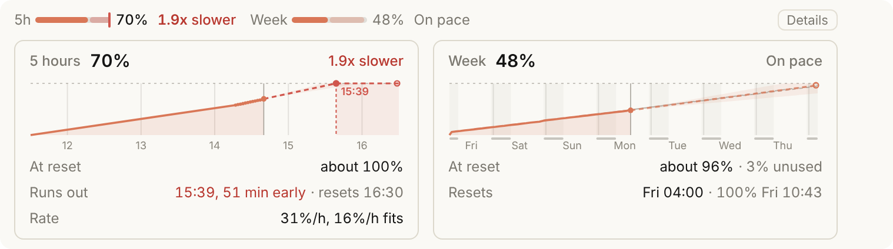
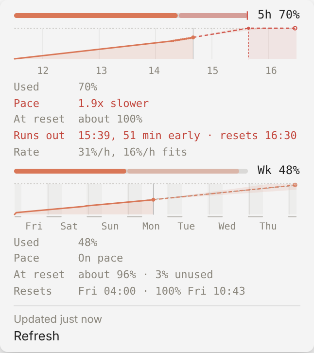

# pacer

**Know if your Claude usage will last until the reset.** pacer is a small
local monitor for Claude's two usage limits, the rolling 5-hour window and
the weekly one. For each it answers three questions, right where you work:
how fast am I spending, how fast can I afford to, and where will I land at
the reset.

<p align="center">
  <picture>
    <source media="(prefers-color-scheme: dark)" srcset="docs/images/band-dark.png">
    
  </picture>
</p>

- **In Claude Code.** A band above the prompt in the Claude Desktop Code tab,
  or a line in the terminal's status line:
  `5h ━━━━╍╍╍╍ 55%  resets 16:30 · Week ━━━━╍╍╍╍ 48%  resets Fri`.
- **Its pace in plain words.** `1.4x faster` when you have room, `On pace`,
  `2x slower` when you will run out early, `Back at 16:30` when you are out.
- **Details.** A chart per window: what you used, the forecast to the reset
  with how sure it is, earlier forecasts to see how well it guesses, the
  week's nights, and when you would run out.
- **Anywhere on a Mac.** The same in the macOS menu bar, with a notification
  when a limit will run out.
- **Learns your week.** The weekly forecast follows your own hours, so a
  quiet night does not read as "plenty of room" and a busy morning does not
  read as "slow down".

It needs no account access: it reads the rate limits Claude Code already
hands to its status line, and keeps a small history on your machine. Python
3.8+ standard library only; macOS, Linux and Windows.

> pacer is an independent project, not affiliated with or endorsed by
> Anthropic. Claude and Claude Code are trademarks of Anthropic, PBC.

## Requirements

- **A Claude Pro or Max plan**, used through Claude Code. Claude Code passes
  the plan's rate limits to the status line and to mods; with an API key
  there are none to show.
- **Claude Code**, the CLI (for the status line) or the Desktop app (for the
  band; mods need a recent version).
- **Python 3.8 or newer** (3.9+ for the optional `/usage` fetch). macOS has
  one with the Command Line Tools; on Windows, install it from python.org or
  with `winget install Python.Python.3.12`.
- **Optional:** [SwiftBar](https://swiftbar.app) for the macOS menu bar.

## Install

macOS and Linux:

```sh
git clone https://github.com/PershinIlya/pacer.git ~/Projects/pacer
cd ~/Projects/pacer
python3 bin/pacer install                                  # a dry run: shows what it would change
python3 bin/pacer install --apply --bin-dir ~/.local/bin
```

Windows, in PowerShell (one command a line):

```powershell
git clone https://github.com/PershinIlya/pacer.git $HOME\Projects\pacer
cd $HOME\Projects\pacer
py -3 bin\pacer install                                    # a dry run
py -3 bin\pacer install --apply --bin-dir $HOME\.local\bin
```

`install --apply` backs up `~/.claude/settings.json`, sets its `statusLine`
(your existing status line keeps running, with pacer's part added), installs
the Desktop mod, and learns a first picture of your week from the timestamps
of your past Claude Code sessions. The status line works at once; restart
Claude Code (or run `/reload-plugins`) for the band. Then run `pacer doctor`
to check everything. [docs/install.md](docs/install.md) has every step and
what each one changes.

**Mac menu bar.** With SwiftBar installed and opened once:

```sh
pacer menubar --install
```

<p align="center">
  <picture>
    <source media="(prefers-color-scheme: dark)" srcset="docs/images/menubar-dark.png">
    
  </picture>
</p>

**Usage from claude.ai, Cowork or another computer.** pacer sees a new level
whenever Claude Code makes a request on this machine. To count everything
else too, let it ask Claude Code's own `/usage` every 10 minutes:
`pacer fetch --every 10` (once, run `claude` in `~/.pacer` and choose "Yes,
I trust this folder": Claude Code shows plan limits only in a trusted folder).

## Uninstall

```sh
pacer uninstall            # a dry run
pacer uninstall --apply
```

It puts your previous status line back (byte for byte when you did not edit
the file since), removes the mod and the menu bar plugin, and leaves your
history in `~/.pacer` (delete it if you want it gone).

## Privacy and safety

- **pacer never reads your credentials** (no OAuth token, no Keychain, no
  `~/.claude/.credentials.json`) and makes no network requests of its own.
  It uses only the `rate_limits` Claude Code gives the status line and the
  mod, and, if you turn it on, what Claude Code's `/usage` prints: Claude
  Code makes that request with its own login.
- **No message content is kept.** From your session transcripts it reads
  only each assistant message's time and token counts, to learn your week's
  rhythm; the text is never stored, printed or logged (a test plants a
  secret and checks the database for it).
- **Everything stays in `~/.pacer`:** a SQLite history (levels, reset times,
  session ids), the config, and logs, readable only by you.
- **Nothing is added to Claude's context**, and nothing changes in
  `settings.json` except the `statusLine`, with a backup first.

## How it works

The 5-hour pace is the slope of your recent usage. The weekly pace walks an
hour-of-week profile of when you usually work, scaled by how you spend this
week and pulled toward your typical week while the week is young. Both carry
an uncertainty that is wide far from the reset and narrows toward it, and a
warning shows only when it holds at the optimistic edge.
[docs/how-it-works.md](docs/how-it-works.md) has the formulas;
[docs/design-decisions.md](docs/design-decisions.md) has the reason for every
rule, often with the case that shaped it.

## More

- [Reading pacer](docs/guide.md): the band, Details, the charts, the menu
  bar, the terminal line.
- [Install in detail](docs/install.md): Windows, what changes on disk,
  upgrading, uninstalling.
- [Reference](docs/reference.md): commands, configuration, data, performance.
- **Something wrong?** `pacer doctor` checks the interpreter, the database,
  the settings wiring and the mod, and says what to do. Errors go to
  `~/.pacer/errors.log`.

## Contributing

Issues and pull requests are welcome: see [CONTRIBUTING.md](CONTRIBUTING.md).
Security issues: please report them privately ([SECURITY.md](SECURITY.md)).

## Credits

pacer reimplements ideas from these projects (read, not run or copied):

- [SeanLF/ccpool](https://github.com/SeanLF/ccpool): least-squares burn on a
  running-max series, the `resets_at` jitter bucket, the epoch-leak guard,
  the off-hour pace floor, the dim-until-it-matters status line, the
  dry-run and backup install.
- [thevibeworks/claude-code-statusline](https://github.com/thevibeworks/claude-code-statusline):
  the decay-weighted hour-of-week profile, the hour-by-hour walk behind
  "dry Thu 09:00" and "N% will expire", and the 5-hour-to-weekly exchange
  rate.
- [thevibeworks/ccpace](https://github.com/thevibeworks/ccpace): the
  sustained-drop rule for resets.
- [fabioconcina/claumon](https://github.com/fabioconcina/claumon): a
  Bayesian forecast with an interval.
- [Astro-Han/claude-pace](https://github.com/Astro-Han/claude-pace): the
  network-free baseline.
- [NathanAB/statusline-anywhere](https://github.com/NathanAB/statusline-anywhere):
  how a mod runs a status-line command and draws it above the prompt.
- [anthropics/claude-code-playground](https://github.com/anthropics/claude-code-playground):
  the sample mods' conventions.

## License

[MIT](LICENSE) © 2026 Ilia Pershin
